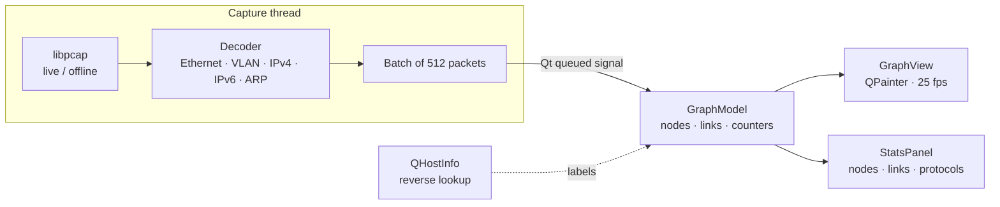

# EtherApe 2026

**Qt 6 / C++20** port of [EtherApe](https://gitlab.com/rghetta/etherape), the
graphical network traffic monitor by Juan Toledo and Riccardo Ghetta.

> Base: EtherApe **0.9.22** (tag `rel-0.9.22`, commit `8753ed7`), compared with
> `main` (0.9.23, commit `1edfbb8`). Licence **GPL-2.0-or-later**, identical to
> the original. Decisions: [`docs/PORTING.md`](docs/PORTING.md); provenance and
> licence: [`NOTICE.md`](NOTICE.md).

The historical code (GTK 3 + libglade + autotools, ~18,000 lines of C) is
replaced by a modern, compact and maintainable base: **CMake + Qt 6 Widgets +
libpcap**.

The goal is to survive the abandonment of the dependencies. To be precise:
**GTK 3 is not dead** (3.24 is still maintained and packaged); what is dead is
**libglade**, unmaintained since 2011, which EtherApe used to load its 3,238
lines of XML UI — GTK itself replaced it with `GtkBuilder`. Add to that
autotools, gnome-canvas/libart and a C GObject model. See
[`docs/PORTING.md`](docs/PORTING.md) for the full analysis and the replacement
table.

## Status

| Feature | State |
|---|---|
| Live capture (libpcap, BPF) | ✅ |
| `.pcap` replay (adjustable speed) | ✅ |
| **Link** (MAC), **IP**, **TCP** (address:port) modes | ✅ |
| Ethernet, **VLAN 802.1Q / QinQ 802.1ad**, IPv4, IPv6 (+ extension headers), ARP, TCP, UDP, ICMP decoding | ✅ |
| Animated graph, force-directed layout, zoom/pan, selection | ✅ |
| Statistics panel (nodes / links / protocols) | ✅ |
| Asynchronous reverse DNS (optional) | ✅ |
| Passive NetBIOS (NBNS responses, UDP/137) | ✅ |
| Dynamic protocol legend | ✅ |
| XML **and JSON** export (menu, `--final-export`) | ✅ |
| Per-link conversations | ✅ |
| Manual node placement (drag/pin, JSON, `--position`) | ✅ |
| Application dissection (HTTP, TLS, DNS, SSH…) | ✅ |
| VLANs displayed (panel, tooltip, conversations, XML/JSON) | ✅ |
| LAN / DMZ / VPN / Internet zone clouds | ✅ |
| Unit tests (`ctest`) + GitHub and GitLab CI | ✅ |
| 10 languages (fr, es, pt_BR, ru, zh_CN, ar, hi, bn, ur + en) | ✅ |
| Display filter (`--show`, "Show" toolbar, completion and help) | ✅ |
| Node search (`Ctrl+F`) | ✅ |
| Throughput chart (5 minutes) | ✅ |
| CSV export of conversations | ✅ |
| `/etc/ethers` (MAC → name) | ✅ |
| Persistent preferences (QSettings) | ✅ |

## Quick install

Releases provide ready-to-run binaries, built by CI on every tag:

| File | Platform | Requirements |
|---|---|---|
| `etherape2026-<version>-x86_64.AppImage` | Linux | **nothing** (Qt 6 is bundled, Wayland and X11 both included); `libfuse2`, or run with `--appimage-extract-and-run` |
| `etherape2026-<version>-linux-x86_64.tar.gz` | Linux | distribution Qt 6 and libpcap; `./install.sh` |
| `EtherApe2026-Setup-<version>.exe` | Windows | **Npcap** (https://npcap.com) for live capture |
| `SHA256SUMS` | — | verify the downloaded files |

```bash
chmod +x etherape2026-*-x86_64.AppImage
./etherape2026-*-x86_64.AppImage                    # live capture: polkit password
./etherape2026-*-x86_64.AppImage -r capture.pcap   # replay, no privilege needed
```

## Build

Dependencies: Qt 6 (Core, Gui, Widgets, Network), libpcap, CMake ≥ 3.21, Ninja.
Qt 6.4 is enough (the version shipped by Ubuntu 24.04 LTS).

```bash
cmake -S . -B build -G Ninja -DCMAKE_BUILD_TYPE=RelWithDebInfo
cmake --build build -j"$(nproc)"
cmake --install build              # or --prefix ~/.local
```

If libpcap is not on the pkg-config path:

```bash
export PKG_CONFIG_PATH=/path/to/libpcap/lib64/pkgconfig
cmake -S . -B build -G Ninja
# or, without an environment variable:
cmake -S . -B build -G Ninja -DPCAP_PREFIX=/path/to/libpcap
```

## Capture without root

libpcap opens AF_PACKET sockets, which requires `CAP_NET_RAW`. Two options:

- do nothing: when the capture is denied, the application offers to elevate
  through **polkit**. The privileged helper is one-shot — it streams the pcap
  data on stdout, and exits with the capture. The password is asked for each
  capture, and the GUI itself stays unprivileged.
- grant the capability once, if you prefer not to use polkit:

```bash
sudo setcap cap_net_raw,cap_net_admin+eip "$(command -v etherape2026)"
```

Running the application as root also works, but is not recommended.

## Usage

```bash
etherape2026                        # default interface, IP mode
etherape2026 -i any -f "tcp port 443"
etherape2026 -r capture.pcap --speed 200
etherape2026 -i eth0 -m tcp -n --node-limit 500
etherape2026 -r capture.pcap --final-export session.xml
etherape2026 -i eth0 --position layout.json
```

| Option | Description |
|---|---|
| `-i, --interface <dev>` | capture interface |
| `-r, --replay <file>` | replay a pcap file |
| `-f, --filter <bpf>` | BPF filter |
| `-m, --mode link\|ip\|tcp` | node granularity |
| `-n, --numeric` | no DNS resolution |
| `--node-limit <n>` | maximum number of displayed nodes |
| `--speed <pct>` | replay speed (0 = maximum) |
| `--final-export <file>` | export the graph as XML at the end of the replay |
| `--position <file>` | load a node layout (JSON) |
| `--show <expr>` | display filter: `proto:http hostname=laptop -vlan:100` |

## Architecture



* **Decoder**: stateless, testable, knows only the bytes and the mode.
* **CaptureWorker**: dedicated thread, non-blocking `pcap_dispatch` + `poll()`,
  thread-safe `requestStop()` through `pcap_breakloop`.
* **GraphModel**: raw counters, exponential link decay, force-directed layout
  (springs + repulsion) in a normalised space.
* **GraphView**: direct `QPainter` painting — no graphics scene, so no per-item
  cost and a rendering that is easy to reason about.

See [`docs/ARCHITECTURE.md`](docs/ARCHITECTURE.md) for the details.

## Languages

The interface is available in **English** (source) plus French, Spanish,
Portuguese (Brazil), Russian, Simplified Chinese, Arabic (RTL), Hindi, Bengali
and Urdu. Technical terms (VLAN, MAC, BPF, DNS, TCP/IP, pcap…) stay in English
in every language. Select one in **Settings → Preferences → Language**, or with
`ui/language` in the settings.

Per-language status and the update procedure:
[`docs/TRANSLATIONS.md`](docs/TRANSLATIONS.md).

## Tests

```bash
cmake -S . -B build -G Ninja -DBUILD_TESTING=ON
cmake --build build
ctest --test-dir build --output-on-failure
```

The core (decoding, NetBIOS, zones, exports) lives in a GUI-free library
(`etherape_core`), so the tests run without a display server. CI covers Linux
and Windows on both GitHub Actions and GitLab CI.

## Windows

Capture goes through **Npcap** (the successor of WinPcap). Requirements:

1. [Npcap](https://npcap.com/) installed on the machine (with "WinPcap
   API-compatible Mode" if you also want older tools).
2. The **Npcap SDK** extracted, for example to `C:\dev\npcap`.
3. MSYS2 **UCRT64** with GCC, Qt 6, CMake and Ninja:

```bash
pacman -S --needed mingw-w64-ucrt-x86_64-gcc \
    mingw-w64-ucrt-x86_64-qt6-base mingw-w64-ucrt-x86_64-cmake \
    mingw-w64-ucrt-x86_64-ninja mingw-w64-ucrt-x86_64-pkgconf
```

Build:

```bash
export MSYSTEM=UCRT64
export PATH=/ucrt64/bin:$PATH
cmake -S . -B build -G Ninja -DCMAKE_BUILD_TYPE=Release \
      -DNPCAP_SDK_DIR=C:/dev/npcap
cmake --build build -j8
cmake --build build --target deploy   # windeployqt: Qt DLLs next to the exe
```

On Windows the capture requires administrator rights: the application offers to
restart itself through the **UAC** prompt (`ShellExecuteEx` + `runas`). There is
no `pkexec` equivalent and no separate helper; the binary stays single-process.

`-DETH_WINDOWS_GUI=ON` produces a windowed executable (no console); by default
the console stays visible to diagnose start-up errors.

## Origin and licence

This project is a **port**, not a fork: it does not take patches from the
historical C code and is not meant to replace it upstream.

| | |
|---|---|
| Original project | EtherApe, © 2001 Juan Toledo, Riccardo Ghetta and contributors |
| Upstream repository | <https://gitlab.com/rghetta/etherape> |
| Former hosting | <https://sourceforge.net/projects/etherape/> |
| Port base | tag `rel-0.9.22` (commit `8753ed7`) |
| Licence | GPL-2.0-or-later ([`COPYING`](COPYING)) |
| Qt 6 | LGPL v3 — compatible with `GPL-2.0-or-later`, dynamically linked |

See [`NOTICE.md`](NOTICE.md) for provenance (what was read in the C sources
before rewriting) and [`docs/PORTING.md`](docs/PORTING.md) for the reasons
behind the port and the features that were not carried over.

## Contact

Questions and bug reports: the **GitHub or GitLab issues** of the repository.
No personal e-mail address is published; the author remains reachable through
his profile on both forges.
