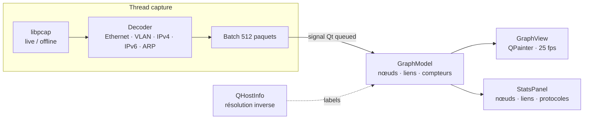

# EtherApe 2026

Portage **Qt 6 / C++20** d'[EtherApe](https://gitlab.com/rghetta/etherape),
le moniteur graphique de trafic réseau de Juan Toledo et Riccardo Ghetta.

> Base : EtherApe **0.9.22** (tag `rel-0.9.22`, commit `8753ed7`), comparé à
> `main` (0.9.23, commit `1edfbb8`). Licence **GPL-2.0-or-later**, identique à
> l'original. Détail des décisions : [`docs/PORTING.md`](docs/PORTING.md) ;
> traçabilité et licence : [`NOTICE.md`](NOTICE.md).
Le code historique (GTK 3 + libglade + autotools, ~18 000 lignes de C) est
remplacé par une base moderne, compacte et maintenable : **CMake + Qt 6
Widgets + libpcap**.

L'objectif est de survivre à l'abandon des dépendances. À noter, pour être
précis : **GTK 3 n'est pas mort** (3.24 est encore maintenu et packagé) ; ce
qui l'était, c'est **libglade**, abandonné depuis 2011, dont EtherApe dépendait
pour charger ses 3 238 lignes de XML d'interface — remplacé dans GTK par
`GtkBuilder`. S'y ajoutaient autotools, gnome-canvas/libart et un modèle
GObject en C. Voir [`docs/PORTING.md`](docs/PORTING.md) pour l'analyse
complète et le tableau des remplacements.

## État

| Fonction | État |
|---|---|
| Capture live (libpcap, BPF) | ✅ |
| Replay de fichier `.pcap` (vitesse réglable) | ✅ |
| Modes **Link** (MAC), **IP**, **TCP** (adresse:port) | ✅ |
| Décodage Ethernet, **VLAN 802.1Q / QinQ 802.1ad**, IPv4, IPv6 (+ ext. headers), ARP, TCP, UDP, ICMP | ✅ |
| Graphe animé, layout force-directed, zoom/pan, sélection | ✅ |
| Panneau statistiques (nœuds / liens / protocoles) | ✅ |
| Résolution DNS inverse asynchrone (optionnelle) | ✅ |
| NetBIOS passif (réponses NBNS UDP/137) | ✅ |
| Légende dynamique des protocoles | ✅ |
| Export XML **et JSON** (menu, `--final-export`) | ✅ |
| Conversations détaillées par lien | ✅ |
| Positionnement manuel (drag/pin, JSON, `--position`) | ✅ |
| Dissection applicative (HTTP, TLS, DNS, SSH…) | ✅ |
| VLAN affichés (panneau, tooltip, conversations, XML/JSON) | ✅ |
| Nuages de zones LAN / DMZ / VPN / Internet | ✅ |
| Tests unitaires (`ctest`) + CI GitLab | ✅ |
| Préférences persistantes (QSettings) | ✅ |

## Compilation

Dépendances : Qt 6 (Core, Gui, Widgets, Network), libpcap, CMake ≥ 3.21, Ninja.

```bash
cmake -S . -B build -G Ninja -DCMAKE_BUILD_TYPE=RelWithDebInfo
cmake --build build -j"$(nproc)"
cmake --install build              # ou --prefix ~/.local
```

Si libpcap n'est pas dans le chemin de pkg-config :

```bash
export PKG_CONFIG_PATH=/chemin/vers/libpcap/lib64/pkgconfig
cmake -S . -B build -G Ninja
```

## Capture sans root

libpcap ouvre les sockets AF_PACKET, ce qui exige `CAP_NET_RAW`. Une seule
commande, une seule fois :

```bash
sudo setcap cap_net_raw,cap_net_admin+eip "$(command -v etherape2026)"
```

Sinon, lancer l'application en root.

## Utilisation

```bash
etherape2026                        # interface par défaut, mode IP
etherape2026 -i any -f "tcp port 443"
etherape2026 -r capture.pcap --speed 200
etherape2026 -i eth0 -m tcp -n --node-limit 500
etherape2026 -r capture.pcap --final-export session.xml
etherape2026 -i eth0 --position layout.json
```

| Option | Description |
|---|---|
| `-i, --interface <dev>` | interface de capture |
| `-r, --replay <file>` | rejoue un fichier pcap |
| `-f, --filter <bpf>` | filtre BPF |
| `-m, --mode link\|ip\|tcp` | granularité des nœuds |
| `-n, --numeric` | pas de résolution DNS |
| `--node-limit <n>` | nombre max de nœuds affichés |
| `--speed <pct>` | vitesse de replay (0 = maximum) |
| `--final-export <file>` | exporte le graphe en XML à la fin du replay |
| `--position <file>` | charge une disposition de nœuds (JSON) |

## Architecture



* **Decoder** : sans état, testable, ne connaît que les octets et le mode.
* **CaptureWorker** : thread dédié, `pcap_dispatch` non bloquant + `poll()`,
  `requestStop()` thread-safe via `pcap_breakloop`.
* **GraphModel** : compteurs bruts, décroissance exponentielle des liens,
  layout force-directed (ressorts + répulsion) dans un espace normalisé.
* **GraphView** : peinture directe au `QPainter` — pas de scène graphique,
  donc pas de coût par item et un rendu trivialement maîtrisé.

Voir [`docs/ARCHITECTURE.md`](docs/ARCHITECTURE.md) pour le détail.

## Tests

```bash
cmake -S . -B build -G Ninja -DBUILD_TESTING=ON
cmake --build build
ctest --test-dir build --output-on-failure
```

Le cœur (décodage, NetBIOS, zones, exports) est dans une bibliothèque sans GUI
(`etherape_core`), donc les tests tournent sans serveur graphique. La CI
GitLab (`.gitlab-ci.yml`) couvre Linux et Windows.

## Windows

La capture passe par **Npcap** (successeur de WinPcap). Prérequis :

1. [Npcap](https://npcap.com/) installé sur la machine (avec l'option
   « WinPcap API-compatible Mode » si tu veux aussi d'anciens outils).
2. **Npcap SDK** décompressé, par exemple `C:\dev\npcap`.
3. MSYS2 **UCRT64** avec GCC, Qt 6, CMake et Ninja :

```bash
pacman -S --needed mingw-w64-ucrt-x86_64-gcc \
    mingw-w64-ucrt-x86_64-qt6-base mingw-w64-ucrt-x86_64-cmake \
    mingw-w64-ucrt-x86_64-ninja mingw-w64-ucrt-x86_64-pkgconf
```

Build :

```bash
export MSYSTEM=UCRT64
export PATH=/ucrt64/bin:$PATH
cmake -S . -B build -G Ninja -DCMAKE_BUILD_TYPE=Release \
      -DNPCAP_SDK_DIR=C:/dev/npcap
cmake --build build -j8
cmake --build build --target deploy   # windeployqt : DLLs Qt à côté de l'exe
```

Sous Windows, la capture exige les droits administrateur : l'application
propose de se relancer via l'invite **UAC** (`ShellExecuteEx` + `runas`).
Il n'y a pas d'équivalent `pkexec` ni de helper séparé ; le binaire reste
mono-processus.

`-DETH_WINDOWS_GUI=ON` produit un exécutable fenêtré (sans console) ; par
défaut la console reste visible pour diagnostiquer les erreurs de démarrage.

## Origine et licence

Ce projet est un **portage**, pas un fork : il ne reprend pas les correctifs du
code C historique et n'a pas vocation à le remplacer en amont.

| | |
|---|---|
| Projet d'origine | EtherApe, © 2001 Juan Toledo, Riccardo Ghetta et contributeurs |
| Dépôt amont | <https://gitlab.com/rghetta/etherape> |
| Ancien hébergement | <https://sourceforge.net/projects/etherape/> |
| Base du portage | tag `rel-0.9.22` (commit `8753ed7`) |
| Licence | GPL-2.0-or-later ([`COPYING`](COPYING)) |
| Qt 6 | LGPL v3 — compatible avec `GPL-2.0-or-later`, liaison dynamique |

Voir [`NOTICE.md`](NOTICE.md) pour la traçabilité (ce qui a été relu dans les
sources C avant réécriture) et [`docs/PORTING.md`](docs/PORTING.md) pour les
raisons du portage et les fonctionnalités non reprises.
