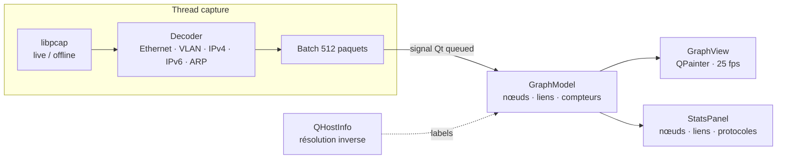

# EtherApe 2026

Portage **Qt 6 / C++20** d'EtherApe, le moniteur graphique de trafic réseau.
Le code historique (GTK 3 + libglade + autotools, ~18 000 lignes de C) est
remplacé par une base moderne, compacte et maintenable : **CMake + Qt 6
Widgets + libpcap**.

L'objectif est de survivre à l'abandon des dépendances : plus de libglade
(obsolète depuis 2011), plus de GtkBuilder XML, plus d'autotools. Seules des
bibliothèques vivantes et largement packagées sont utilisées.

## État

| Fonction | État |
|---|---|
| Capture live (libpcap, BPF) | ✅ |
| Replay de fichier `.pcap` (vitesse réglable) | ✅ |
| Modes **Link** (MAC), **IP**, **TCP** (adresse:port) | ✅ |
| Décodage Ethernet, 802.1Q/802.1ad, IPv4, IPv6 (+ ext. headers), ARP, TCP, UDP, ICMP | ✅ |
| Graphe animé, layout force-directed, zoom/pan, sélection | ✅ |
| Panneau statistiques (nœuds / liens / protocoles) | ✅ |
| Résolution DNS inverse asynchrone (optionnelle) | ✅ |
| Préférences persistantes (QSettings) | ✅ |
| Export XML, NetBIOS, conversations détaillées | ⬜ (non porté) |

## Compilation

Dépendances : Qt 6 (Core, Gui, Widgets, Network), libpcap, CMake ≥ 3.21, Ninja.

```bash
cmake -S . -B build -G Ninja -DCMAKE_BUILD_TYPE=RelWithDebInfo
cmake --build build -j"$(nproc)"
cmake --install build              # ou --prefix ~/.local
```

Si libpcap n'est pas dans le chemin de pkg-config :

```bash
export PKG_CONFIG_PATH=/chemin/vers/libpcap/lib64/pkgconfig
cmake -S . -B build -G Ninja
```

## Capture sans root

libpcap ouvre les sockets AF_PACKET, ce qui exige `CAP_NET_RAW`. Une seule
commande, une seule fois :

```bash
sudo setcap cap_net_raw,cap_net_admin+eip "$(command -v etherape2026)"
```

Sinon, lancer l'application en root.

## Utilisation

```bash
etherape2026                        # interface par défaut, mode IP
etherape2026 -i any -f "tcp port 443"
etherape2026 -r capture.pcap --speed 200
etherape2026 -i eth0 -m tcp -n --node-limit 500
```

| Option | Description |
|---|---|
| `-i, --interface <dev>` | interface de capture |
| `-r, --replay <file>` | rejoue un fichier pcap |
| `-f, --filter <bpf>` | filtre BPF |
| `-m, --mode link\|ip\|tcp` | granularité des nœuds |
| `-n, --numeric` | pas de résolution DNS |
| `--node-limit <n>` | nombre max de nœuds affichés |
| `--speed <pct>` | vitesse de replay (0 = maximum) |

## Architecture



* **Decoder** : sans état, testable, ne connaît que les octets et le mode.
* **CaptureWorker** : thread dédié, `pcap_dispatch` non bloquant + `poll()`,
  `requestStop()` thread-safe via `pcap_breakloop`.
* **GraphModel** : compteurs bruts, décroissance exponentielle des liens,
  layout force-directed (ressorts + répulsion) dans un espace normalisé.
* **GraphView** : peinture directe au `QPainter` — pas de scène graphique,
  donc pas de coût par item et un rendu trivialement maîtrisé.

Voir [`docs/ARCHITECTURE.md`](docs/ARCHITECTURE.md) pour le détail.

## Licence

GPL-2.0-or-later, comme EtherApe original (© 2001 Juan Toledo,
Riccardo Ghetta et contributeurs).
