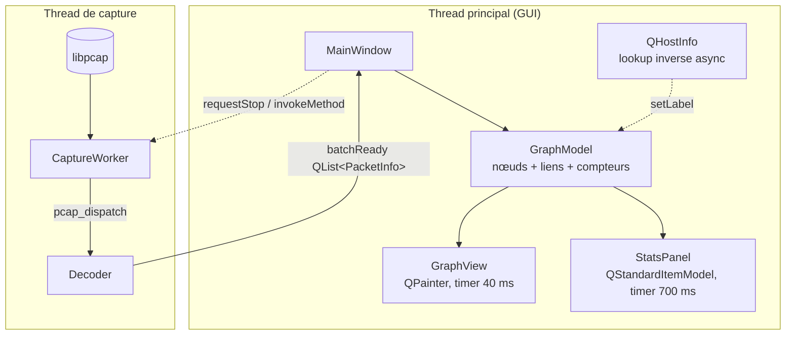
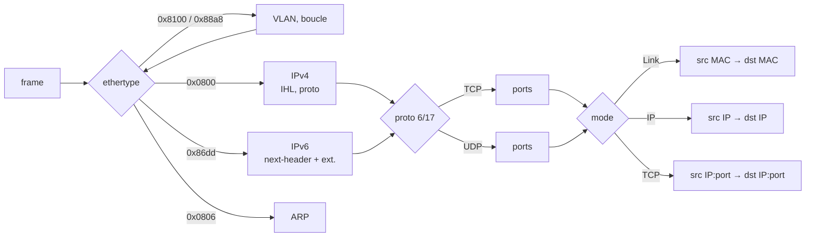
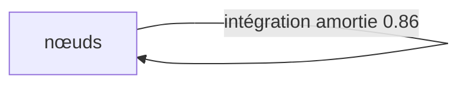

# Architecture

## Vue d'ensemble

Deux threads seulement :

1. **GUI** : tout l'état affiché vit ici (`GraphModel`, widgets Qt). Aucun
   verrou, aucune structure partagée mutable.
2. **Capture** : `CaptureWorker` possède le handle pcap et le `Decoder`.
   Il communique uniquement par signaux Qt en connexion *queued*, par lots de
   512 paquets. Le coût par paquet côté GUI reste très inférieur au coût de
   décodage, donc le producteur ne peut pas saturer la boucle d'événements
   (throttling à 1 ms par 32 lots en mode « vitesse maximale »).

## Décodage

`Decoder::decode()` retourne un `PacketInfo` autonome (aucun pointeur vers le
buffer libpcap), ce qui rend le passage inter-thread sûr sans copie
supplémentaire.

## Modèle de graphe

* `Node` : `id` stable, `label` résolu, position normalisée `[0,1]²`,
  compteurs `packets`/`bytes`.
* `Link` : paire de nœuds **non orientée** (le trafic des deux sens est
  fusionné, comme dans EtherApe), protocole dominant, `intensity` ∈ [0,1]
  utilisée pour l'épaisseur et l'opacité.

Décroissance : `intensity *= exp(-0.025 / tau)` à chaque tick, avec `tau` le
délai configurable (4 s par défaut). Un lien disparaît quand son intensité
tombe sous 0.02 et qu'il est inactif depuis `4·tau`.

Le layout est un petit système physique exécuté à 25 Hz :

Coût : O(n²), borné par `nodeLimit` (300 par défaut, réglable).

## Rendu

`GraphView` est un `QWidget` qui peint directement :

1. dégradé de fond issu de la `QPalette` (fonctionne en thème clair et sombre) ;
2. liens (largeur `0.6 + 7·intensity`, couleur par protocole, alpha animé) ;
3. nœuds (rayon `∝ √bytes`, couleur par type) et libellés éllipsés ;
4. légende + compteurs.

Pas de `QGraphicsScene` : avec quelques centaines d'objets, le repaint direct
est plus simple, plus rapide, et évite toute une couche d'abstraction à
maintenir.

## Choix de portage

| Ancien | Nouveau | Raison |
|---|---|---|
| GTK 3 + libglade XML (3 200 lignes) | Qt 6 Widgets construits en C++ | libglade est mort ; le XML généré n'est pas maintenable |
| GObject / signaux C | `QObject` / signaux typés | sécurité de compilation |
| autotools | CMake + Ninja | standard actuel, builds reproductibles |
| `GdkInput` / `select()` dans le thread UI | thread dédié + `pcap_dispatch` | l'UI ne gèle plus |
| processus privilégié séparé + protocole maison | `setcap` sur le binaire | inutile de maintenir un protocole IPC pour un seul cas d'usage |
| `GHashTable` de nœuds | `QVector<Node>` + `QHash<QString,int>` | localité mémoire et index O(1) |
| libart / gnome-canvas | `QPainter` | déjà là, accéléré, antialiasé |

## Ce qui n'est pas porté (volontairement)

L'export XML, les conversations détaillées, NetBIOS et le positionnement manuel
de nœuds représentaient ~40 % du code historique pour un usage marginal. Ils
peuvent revenir sous forme de modules indépendants sans toucher au cœur.
