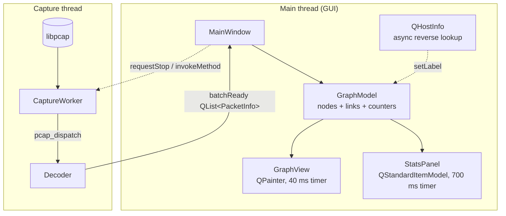
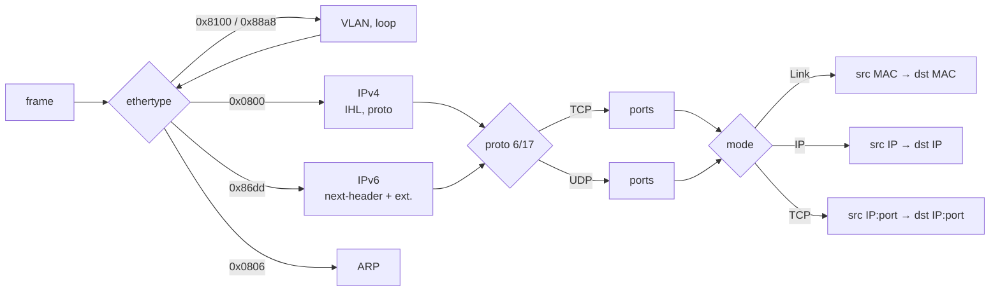
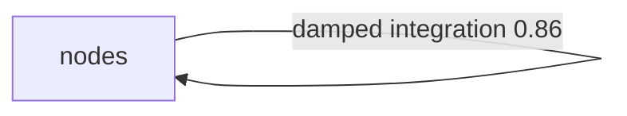

# Architecture

## Overview

Only two threads:

1. **GUI**: all displayed state lives here (`GraphModel`, Qt widgets). No lock,
   no shared mutable structure.
2. **Capture**: `CaptureWorker` owns the pcap handle and the `Decoder`. It
   communicates only through Qt signals with *queued* connections, in batches
   of 512 packets. The per-packet cost on the GUI side stays well below the
   decoding cost, so the producer cannot saturate the event loop (throttling to
   1 ms per 32 batches in "maximum speed" mode).

## Decoding

`Decoder::decode()` returns a self-contained `PacketInfo` (no pointer into the
libpcap buffer), which makes the cross-thread hand-off safe without an extra
copy.

## Graph model

* `Node`: stable `id`, resolved `label`, normalised position `[0,1]²`,
  `packets`/`bytes` counters.
* `Link`: **undirected** node pair (traffic in both directions is merged, as in
  EtherApe), dominant protocol, `intensity` ∈ [0,1] used for width and opacity.

Decay: `intensity *= exp(-0.025 / tau)` on every tick, with `tau` the
configurable delay (4 s by default). A link disappears when its intensity falls
below 0.02 and it has been idle for `4·tau`.

The layout is a small physical system running at 25 Hz:

Cost: O(n²), bounded by `nodeLimit` (300 by default, configurable).

## Rendering

`GraphView` is a `QWidget` that paints directly:

1. background gradient taken from the `QPalette` (works in light and dark
   themes);
2. links (width `0.6 + 7·intensity`, colour per protocol, animated alpha);
3. nodes (radius `∝ √bytes`, colour per kind) and elided labels;
4. legend + counters.

No `QGraphicsScene`: with a few hundred objects, direct repaint is simpler,
faster, and avoids a whole abstraction layer to maintain.

## Porting choices

| Before | After | Reason |
|---|---|---|
| GTK 3 + libglade XML (3,200 lines) | Qt 6 Widgets built in C++ | libglade is dead; generated XML is not maintainable |
| GObject / C signals | `QObject` / typed signals | compile-time safety |
| autotools | CMake + Ninja | current standard, reproducible builds |
| `GdkInput` / `select()` in the UI thread | dedicated thread + `pcap_dispatch` | the UI no longer freezes |
| separate privileged process + custom IPC protocol | one-shot `pkexec` helper streaming pcap on stdout | no long-lived IPC to maintain; one password per capture |
| `GHashTable` of nodes | `QVector<Node>` + `QHash<QString,int>` | memory locality and O(1) index |
| libart / gnome-canvas | `QPainter` | already there, accelerated, antialiased |

## Not ported

Two minor things from the original are absent: `--signal-export` (SIGUSR1) and
the old demo/documentation. They are replaced by the menu export and by
`README.md` + `docs/`. Everything else in the feature table of
[`PORTING.md`](PORTING.md) is implemented, and some behaviour is new: zone
clouds, IPv4/IPv6 fragment reassembly, VLAN display, JSON export and the
display filter.
