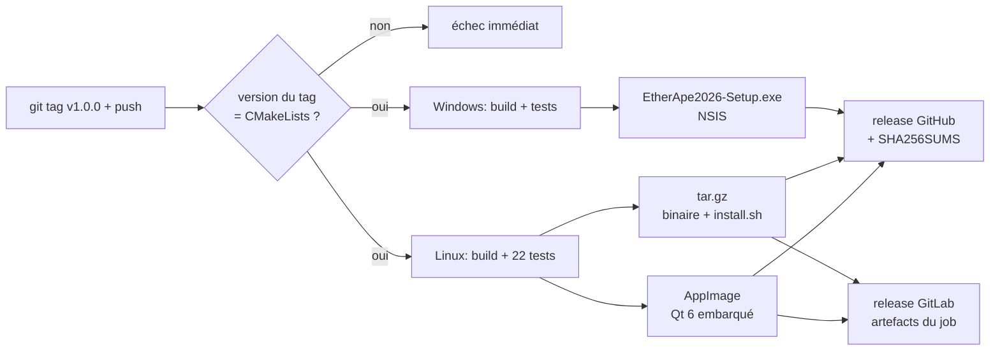

# Packaging et publication

Un tag `vX.Y.Z` déclenche la construction des exécutables et la création d'une
release. Rien n'est compilé à la main pour publier.



## Ce que reçoit quelqu'un qui veut essayer

| Fichier | Plateforme | Ce qu'il faut installer |
|---|---|---|
| `etherape2026-1.0.0-x86_64.AppImage` | Linux | rien (Qt 6 est dedans) ; `libfuse2`, ou lancer avec `--appimage-extract-and-run` |
| `etherape2026-1.0.0-linux-x86_64.tar.gz` | Linux | Qt 6 et libpcap de la distribution ; `./install.sh` |
| `EtherApe2026-Setup-1.0.0.exe` | Windows | **Npcap** (https://npcap.com) pour la capture live |
| `SHA256SUMS` | — | vérification des trois fichiers ci-dessus |

La capture live demande `CAP_NET_RAW` : l'application éléve ses droits via
polkit (Linux) ou UAC (Windows), jamais par `setcap` sur le binaire installé.

## Recettes locales (hors CI)

| Format | Fichier | Commande |
|---|---|---|
| Archive + `install.sh` | `scripts/package-linux.sh` | `./scripts/package-linux.sh build dist` |
| AppImage | `scripts/build-appimage.sh` | `./scripts/build-appimage.sh build` |
| Installeur Windows | `scripts/build-installer-windows.sh` | `./scripts/build-installer-windows.sh build` |
| RPM | `packaging/rpm/etherape2026.spec` | voir ci-dessous |
| Flatpak | `packaging/flatpak/org.etherape.EtherApe2026.yml` | `flatpak-builder --user …` |

## AppImage

`linuxdeploy`, `linuxdeploy-plugin-qt` et `appimagetool` doivent être dans le
`PATH` (voir l'en-tête du script). Deux détails appris à l'usage :

- `APPIMAGE_EXTRACT_AND_RUN=1` : ces outils sont eux-mêmes des AppImages et
  n'ont pas besoin de FUSE pour tourner (c'est ce que fait la CI) ;
- `NO_STRIP=1` : le `strip` embarqué par `linuxdeploy` est plus ancien que la
  section `.relr.dyn` produite par les chaînes de compilation récentes ; sans
  cela, le déploiement des bibliothèques Qt échoue.

## RPM

Le spec produit un paquet **binaire** : l'archive de `package-linux.sh` contient
déjà l'exécutable, Qt 6 et libpcap restant des paquets de la distribution. Pas
de `%cmake` — reconstruire depuis les sources demanderait toute la chaîne Qt sur
la machine d'empaquetage.

```bash
./scripts/package-linux.sh build dist
cp dist/etherape2026-1.0.0-linux-x86_64.tar.gz ~/rpmbuild/SOURCES/
rpmbuild -bb packaging/rpm/etherape2026.spec
```

## Windows

```bash
export MSYSTEM=UCRT64
export PATH=/ucrt64/bin:$PATH
pacman -S --needed mingw-w64-ucrt-x86_64-nsis
NPCAP_SDK_DIR=C:/npcap-sdk ./scripts/build-installer-windows.sh build
```

`scripts/build-windows.sh` fait la configuration, la compilation,
`windeployqt` et la copie des DLL MinGW ; le script d'installeur ne fait
qu'ajouter `makensis`. Le bloc de version de l'exe est généré par CMake depuis
`data/windows.rc.in`, il ne peut donc pas diverger de `CMakeLists.txt`.

L'installeur crée les raccourcis (Bureau, menu Démarrer), enregistre l'entrée
« Applications et fonctionnalités » et fournit un désinstalleur.

**Npcap n'est pas embarqué** : son pilote signé exige une installation
interactive. L'installeur le rappelle à la fin.

## Flatpak

Le manifeste construit libpcap puis l'application avec le runtime
`org.kde.Platform` (Qt 6).

> **Limite assumée** : un Flatpak ne peut pas ouvrir de socket `AF_PACKET`
> avec `CAP_NET_RAW`. **La capture live ne fonctionne donc pas dans le bac à
> sable** ; le replay de fichiers, l'interface, le graphe et les exports
> fonctionnent normalement.

## Ce qui reste manuel

- **Signature** des paquets (GPG pour AppImage/RPM, Authenticode pour
  l'installeur Windows) : à faire avec tes propres clés.
- **Mises à jour automatiques** : aucune n'est implémentée ; un paquet
  Flatpak/AppImage suit son propre canal, Windows doit être remplacé.
- La release GitLab pointe vers les artefacts du job ; les fichiers Windows
  sont attachés à la release GitHub, qui les construit.
