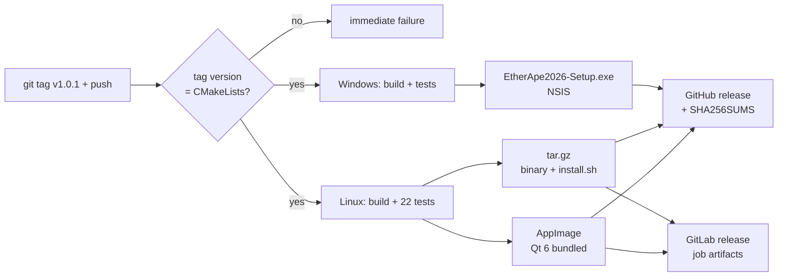

# Packaging and publishing

A `vX.Y.Z` tag builds the executables and creates a release. Nothing is compiled
by hand to publish.



## What someone who wants to try gets

| File | Platform | What to install |
|---|---|---|
| `etherape2026-<version>-x86_64.AppImage` | Linux | nothing (Qt 6 is inside); `libfuse2`, or run with `--appimage-extract-and-run` |
| `etherape2026-<version>-linux-x86_64.tar.gz` | Linux | distribution Qt 6 and libpcap; `./install.sh` |
| `EtherApe2026-Setup-<version>.exe` | Windows | **Npcap** (https://npcap.com) for live capture |
| `SHA256SUMS` | — | verification of the three files above |

Live capture requires `CAP_NET_RAW`: the application elevates through polkit
(Linux) or UAC (Windows), or you can grant the capability with `setcap`.

## Local recipes (outside CI)

| Format | File | Command |
|---|---|---|
| Archive + `install.sh` | `scripts/package-linux.sh` | `./scripts/package-linux.sh build dist` |
| AppImage | `scripts/build-appimage.sh` | `./scripts/build-appimage.sh build` |
| Windows installer | `scripts/build-installer-windows.sh` | `./scripts/build-installer-windows.sh build` |
| RPM | `packaging/rpm/etherape2026.spec` | see below |
| Flatpak | `packaging/flatpak/org.etherape.EtherApe2026.yml` | `flatpak-builder --user …` |

## AppImage

`linuxdeploy`, `linuxdeploy-plugin-qt` and `appimagetool` must be on the `PATH`
(see the header of the script). Four details learned the hard way:

- `APPIMAGE_EXTRACT_AND_RUN=1`: these tools are AppImages themselves and do not
  need FUSE to run (this is what CI does);
- `NO_STRIP=1`: the `strip` bundled with `linuxdeploy` predates the `.relr.dyn`
  section emitted by recent toolchains; without it, deploying the Qt libraries
  fails;
- the Wayland platform plugin must be deployed explicitly, otherwise only the
  **xcb** plugin of the build machine is bundled and the application falls back
  to XWayland on Wayland desktops. The script detects the available plugin names
  (`libqwayland.so` since Qt 6.5, `libqwayland-egl.so` +
  `libqwayland-generic.so` in 6.4) and passes them through
  `EXTRA_PLATFORM_PLUGINS`; the plugin must be installed on the runner
  (`qt6-wayland` on Ubuntu);
- the AppDir must be created on an executable filesystem: `linuxdeploy` runs
  `ldd` on the staged binary, and `ldd` answers "not a dynamic executable" when
  the file sits on a `noexec` mount (`/dev/shm` on CI runners and in
  containers).

## RPM

The spec produces a **binary** package: the archive from `package-linux.sh`
already contains the executable, while Qt 6 and libpcap remain distribution
packages. No `%cmake` — rebuilding from source would require the whole Qt
toolchain on the packaging machine.

```bash
./scripts/package-linux.sh build dist
cp dist/etherape2026-1.0.1-linux-x86_64.tar.gz ~/rpmbuild/SOURCES/
rpmbuild -bb packaging/rpm/etherape2026.spec
```

## Windows

```bash
export MSYSTEM=UCRT64
export PATH=/ucrt64/bin:$PATH
pacman -S --needed mingw-w64-ucrt-x86_64-nsis
NPCAP_SDK_DIR=C:/npcap-sdk ./scripts/build-installer-windows.sh build
```

`scripts/build-windows.sh` does the configuration, the build, `windeployqt` and
the copy of the MinGW DLLs; the installer script only adds `makensis`. The
version block of the executable is generated by CMake from
`data/windows.rc.in`, so it cannot drift from `CMakeLists.txt`.

The installer creates the shortcuts (Desktop, Start menu), registers the
"Apps & features" entry and provides an uninstaller.

**Npcap is not bundled**: its signed driver requires an interactive
installation. The installer reminds the user at the end.

## Flatpak

The manifest builds libpcap, then the application, against the
`org.kde.Platform` runtime (Qt 6).

> **Accepted limitation**: a Flatpak cannot open an `AF_PACKET` socket with
> `CAP_NET_RAW`. **Live capture therefore does not work inside the sandbox**;
> file replay, the interface, the graph and the exports work normally.

## What remains manual

- **Signing** the packages (GPG for AppImage/RPM, Authenticode for the Windows
  installer): to be done with your own keys.
- **Automatic updates**: none is implemented; a Flatpak/AppImage package
  follows its own channel, Windows must be replaced.
- The GitLab release points to the job artifacts; the Windows files are attached
  to the GitHub release, which builds them.
