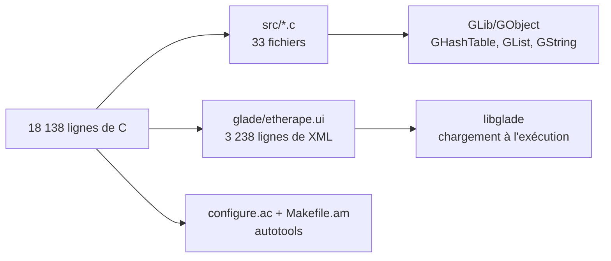
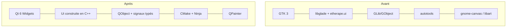
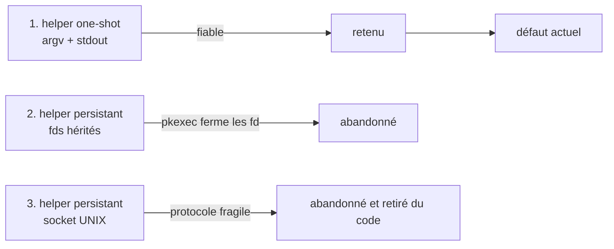

# Pourquoi ce portage

Document de décision : ce qui motivait le portage d'EtherApe (C/GTK 3/libglade)
vers Qt 6, ce qui a été remplacé, et ce qui a été volontairement laissé de côté.

## Point de départ

Le code d'origine (0.9.22 / 0.9.23) représente ~18 100 lignes de C :

## Pourquoi GTK 3 n'était pas le vrai problème

Il faut être précis, parce que « GTK+ c'est vieux » est une simplification :

* **GTK 3 est encore maintenu** (série 3.24, correctifs de sécurité) et reste
  packagé par toutes les distributions. Ce n'est pas une bibliothèque morte.
* Le problème réel est **libglade**, qui n'est plus maintenu depuis 2011 et a
  été remplacé par `GtkBuilder` dans GTK lui-même. EtherApe chargeait son
  interface depuis `glade/etherape.ui`, un fichier XML de 3 238 lignes
  généré par Glade — impossible à maintenir à la main, et dont le
  chargement échoue silencieusement quand le fichier manque.
* L'écosystème autour est daté : autotools, `gnome-doc-utils`, `libart`,
  GObject/GLib en C, sans typage fort ni gestion de mémoire sûre.
* GNOME a basculé sur GTK 4 puis 5 : GTK 3 ne reçoit plus de fonctionnalités,
  seulement des correctifs. Un projet neuf en 2026 qui viserait GTK devrait
  viser GTK 4, pas 3.

Autrement dit : le problème n'était pas « GTK » mais **l'âge de la pile
libglade/autotools** et le coût de maintenance d'un modèle C/GObject.

## Pourquoi Qt 6

| Critère | Constat |
|---|---|
| Disponibilité | Qt 6 est packagé par toutes les distributions, et fourni par MSYS2/UCRT64 sous Windows |
| Périmètre | `Core`, `Gui`, `Widgets`, `Network` couvrent tout le besoin, sans dépendance tierce |
| Rendu | `QPainter` remplace gnome-canvas/libart : antialiasing, thème clair/sombre, zoom |
| Threads | signaux typés + `QThread` : plus simple que le `select()`/fork historique |
| Réseau | `QHostInfo` fournit la résolution inverse **asynchrone** sans thread dédié |
| Configuration | `QSettings` (INI sous Linux, registre sous Windows) au lieu de GSettings |
| Build | CMake + Ninja, standard actuel, cross-compilation et CI triviaux |
| Windows | une seule base de code, Npcap au lieu de libpcap, UAC au lieu de pkexec |

Résultat mesurable : **~3 000 lignes de C++20** contre 18 100 lignes de C, pour
un périmètre fonctionnel comparable (voir le tableau plus bas).

### Compatibilité de licence

Le projet est `GPL-2.0-or-later` ; Qt 6 est sous **LGPL v3** (ou GPL v3).
Comme « or-later » autorise la redistribution sous GPL v3, les deux sont
compatibles. Qt est lié dynamiquement.

## Ce qui a remplacé quoi

| Ancien | Nouveau | Raison |
|---|---|---|
| `glade/etherape.ui` (3 238 lignes XML) | widgets construits en C++ | libglade mort, XML ingérable |
| GObject / signaux `G_CALLBACK` | `QObject` / signaux typés | vérification à la compilation |
| `GHashTable`, `GList` | `QHash`, `QVector` | localité mémoire, API moderne |
| autotools | CMake + Ninja | reproductibilité, CI |
| `select()` + processus privilégié maison | thread dédié + `pcap_dispatch` | UI fluide, pas de protocole IPC à maintenir |
| gnome-canvas / libart | `QPainter` | déjà présent, accéléré |
| `getnameinfo` bloquant | `QHostInfo` asynchrone | l'UI ne gèle plus pendant les lookups |
| GSettings | `QSettings` | portable Windows/Linux |

## Fonctionnalités : avant / après

| Fonction d'origine | État dans ce portage |
|---|---|
| Modes link / ip / tcp | ✅ |
| Capture live + filtre BPF | ✅ (libpcap, Npcap sous Windows) |
| Replay de fichiers pcap | ✅ avec vitesse réglable |
| Diagramme animé (nœuds, liens, intensité) | ✅ + nuages de zones, zoom, épinglage |
| Panneau de statistiques | ✅ nœuds / liens / protocoles |
| Export XML | ✅ (même schéma) + JSON |
| Résolution DNS inverse | ✅ asynchrone, par nom complet |
| NetBIOS | ✅ **passif** (réponses NBNS) au lieu de requêtes actives |
| Conversations détaillées | ✅ avec compteurs par sens et VLAN |
| Positionnement manuel des nœuds | ✅ JSON, drag & drop, `--position` |
| VLAN 802.1Q / QinQ | ✅ (l'original ignorait l'identifiant) |
| Interface en ligne de commande | ✅ `-i -r -f -m -n --node-limit --speed --final-export --position` |
| Démonstration / documentation | ⬜ non portée (le README et `docs/` la remplacent) |
| `--signal-export` (SIGUSR1) | ⬜ non porté (export à la demande via le menu) |

## Les trois itérations du privilège root

Le point le plus délicat du portage, documenté ici parce qu'il a coûté cher :

Le code du helper persistant a été **supprimé** (novembre 2026) : il n'était
plus exercé et constituait un piège. Seul le chemin one-shot subsiste, avec
le debug `--debug` et les traces `ETHERAPE_DEBUG`.

`pkexec` est setuid : il **ferme les descripteurs au-delà de 2** et ne relaie
pas notre `stdin`. Seul le chemin « argv + stdout » est robuste, c'est donc le
comportement par défaut ; le helper persistant reste derrière
`ETHERAPE_PERSISTENT_HELPER=1`.

## Références

* Dépôt amont : <https://gitlab.com/rghetta/etherape>
* Journal des versions originales : `NEWS` du dépôt amont
* Page de manuel d'origine : `etherape.1`
* Documentation de libpcap / Npcap : <https://www.tcpdump.org/>,
  <https://npcap.com/>
