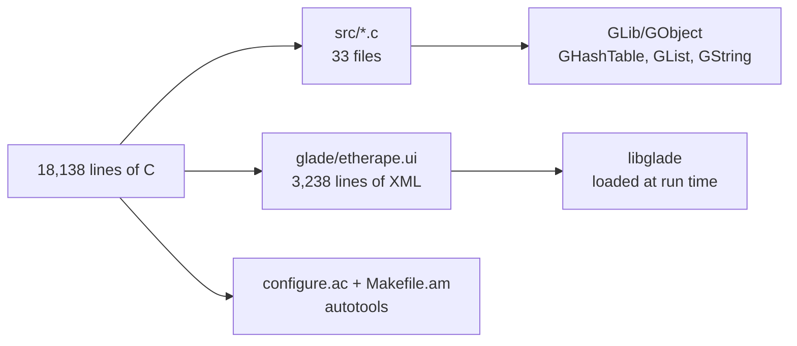
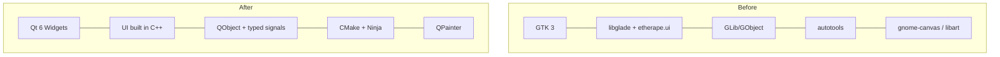
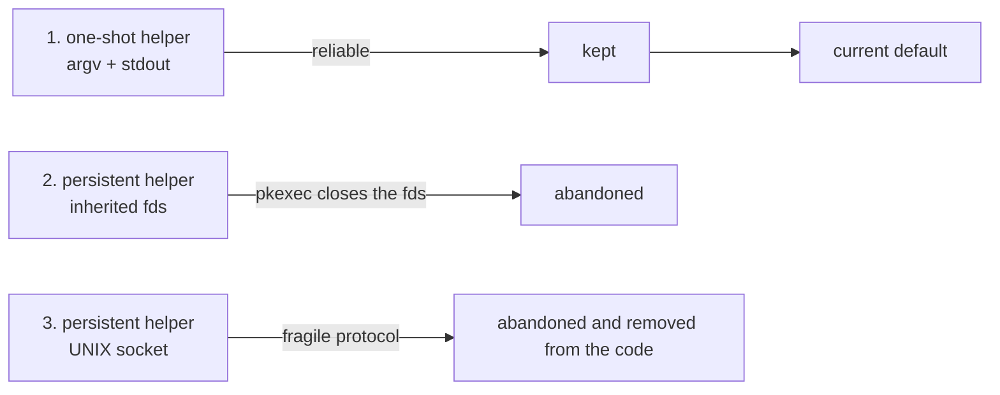

# Why this port

Decision document: what motivated porting EtherApe (C/GTK 3/libglade) to Qt 6,
what was replaced, and what was deliberately left out.

## Starting point

The original code (0.9.22 / 0.9.23) is ~18,100 lines of C:

## Why GTK 3 was not the real problem

Precision matters here, because "GTK is old" is an oversimplification:

* **GTK 3 is still maintained** (3.24 series, security fixes) and is packaged
  by every distribution. It is not a dead library.
* The real problem is **libglade**, unmaintained since 2011 and replaced by
  `GtkBuilder` inside GTK itself. EtherApe loaded its interface from
  `glade/etherape.ui`, a 3,238-line XML file generated by Glade — impossible to
  maintain by hand, and whose loading fails silently when the file is missing.
* The surrounding ecosystem is dated: autotools, `gnome-doc-utils`, `libart`,
  GObject/GLib in C, without strong typing or safe memory management.
* GNOME moved to GTK 4: GTK 3 no longer receives features, only fixes. A new
  project in 2026 that targeted GTK should target GTK 4, not 3.

In other words: the problem was not "GTK" but **the age of the
libglade/autotools stack** and the maintenance cost of a C/GObject model.

## Why Qt 6

| Criterion | Observation |
|---|---|
| Availability | Qt 6 is packaged by every distribution, and provided by MSYS2/UCRT64 on Windows |
| Scope | `Core`, `Gui`, `Widgets`, `Network` cover the whole need, with no third-party dependency |
| Rendering | `QPainter` replaces gnome-canvas/libart: antialiasing, light/dark themes, zoom |
| Threads | typed signals + `QThread`: simpler than the historical `select()`/fork |
| Network | `QHostInfo` provides **asynchronous** reverse resolution without a dedicated thread |
| Configuration | `QSettings` (INI on Linux, registry on Windows) instead of GSettings |
| Build | CMake + Ninja, current standard, cross-compilation and CI are trivial |
| Windows | one code base, Npcap instead of libpcap, UAC instead of pkexec |

Measurable result: **~7,400 lines of C++20** against 18,100 lines of C, for a
comparable functional scope (see the table below).

### Licence compatibility

The project is `GPL-2.0-or-later`; Qt 6 is **LGPL v3** (or GPL v3). Since
"or-later" allows redistribution under GPL v3, the two are compatible. Qt is
linked dynamically.

## What replaced what

| Before | After | Reason |
|---|---|---|
| `glade/etherape.ui` (3,238 lines of XML) | widgets built in C++ | libglade is dead, XML is unmanageable |
| GObject / `G_CALLBACK` signals | `QObject` / typed signals | checked at compile time |
| `GHashTable`, `GList` | `QHash`, `QVector` | memory locality, modern API |
| autotools | CMake + Ninja | reproducibility, CI |
| `select()` + custom privileged process | dedicated thread + `pcap_dispatch` | smooth UI, no IPC protocol to maintain |
| gnome-canvas / libart | `QPainter` | already present, accelerated |
| blocking `getnameinfo` | asynchronous `QHostInfo` | the UI no longer freezes during lookups |
| GSettings | `QSettings` | portable Windows/Linux |

## Features: before / after

| Original feature | State in this port |
|---|---|
| link / ip / tcp modes | ✅ |
| Live capture + BPF filter | ✅ (libpcap, Npcap on Windows) |
| pcap file replay | ✅ with adjustable speed |
| Animated diagram (nodes, links, intensity) | ✅ + zone clouds, zoom, pinning |
| Statistics panel | ✅ nodes / links / protocols |
| XML export | ✅ (same schema) + JSON |
| Reverse DNS resolution | ✅ asynchronous, by full name |
| NetBIOS | ✅ **passive** (NBNS responses) instead of active queries |
| Detailed conversations | ✅ with per-direction counters and VLAN |
| Manual node placement | ✅ JSON, drag & drop, `--position` |
| VLAN 802.1Q / QinQ | ✅ (the original ignored the identifier) |
| Command-line interface | ✅ `-i -r -f -m -n --node-limit --speed --final-export --position` |
| Demo / documentation | ⬜ not ported (README and `docs/` replace it) |
| `--signal-export` (SIGUSR1) | ⬜ not ported (export on demand from the menu) |

## The three iterations of the root privilege

The most delicate part of the port, documented here because it cost a lot:

The code of the persistent helper was **deleted** (November 2026): it was no
longer exercised and had become a trap. Only the one-shot path remains, with
`--debug` and the `ETHERAPE_DEBUG` traces.

`pkexec` is setuid: it **closes file descriptors above 2** and does not forward
our `stdin`. Only the "argv + stdout" path is robust, so it is the default and
the only implementation.

## References

* Upstream repository: <https://gitlab.com/rghetta/etherape>
* Changelog of the original versions: `NEWS` in the upstream repository
* Original manual page: `etherape.1`
* libpcap / Npcap documentation: <https://www.tcpdump.org/>,
  <https://npcap.com/>
